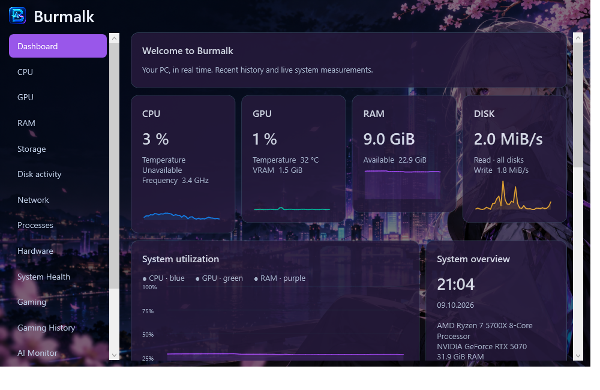
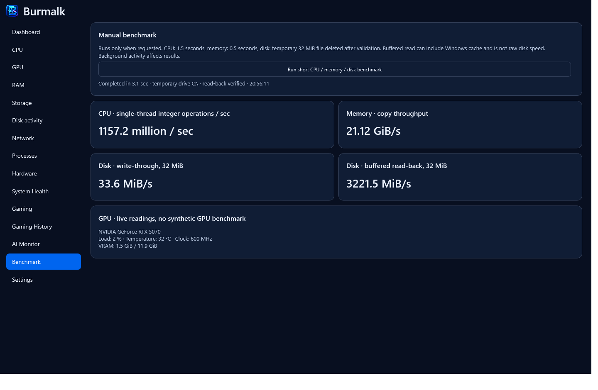

# Burmalk

**Мониторинг компьютера для Windows 10/11 x64.** CPU, GPU, память, диски, сеть, процессы и игровой оверлей в одном приложении.

## Скачать и запустить

Стабильная версия: [Burmalk 1.1.7](https://github.com/vetallitle1231-sketch/burmalk/releases/tag/v1.1.7). Экспериментальное обновление: **1.1.9** — 3D PC VIEW, PC PASSPORT и PC RANK. [Что нового](docs/RELEASE-NOTES-1.1.9.md). Установщик находится в `dist/Burmalk-Setup-1.1.9.exe` после сборки. Ярлык появится на рабочем столе и в меню «Пуск». .NET включён, интернет для установки самой программы не требуется. Для игрового оверлея дополнительно нужен RTSS.

Локальный [сайт Burmalk](website/index.html) открывается в браузере без сервера. Кнопки скачивания на нём ведут к установщику в GitHub Releases.

Windows 10 версии 2004 и новее / Windows 11, x64. Установка для текущего пользователя в `%LocalAppData%\Programs\Burmalk`. Удаление через «Установленные приложения» Windows. Настройки, история и своё фото остаются в `%LocalAppData%\Burmalk`.

## Что умеет

- 19 разделов: все существующие вкладки, OVERCLOCK, 3D PC VIEW, PC PASSPORT и PC RANK.
- 3D PC VIEW: универсальная модель корпуса с реальными характеристиками и датчиками выбранной детали, вращением 360°, масштабом и подсветкой. Анимации выключаются вне вкладки.
- PC PASSPORT: три оформления; PNG, вертикальная карточка, подробный PDF и буфер обмена. Имя ПК скрыто по умолчанию, серийные номера не включаются.
- PC RANK: пять эмблем, эффекты получения ранга, свечение на перемещаемом виджете главной страницы, сохранение результата. [Методика](docs/PC-RANK-METHOD.md) — относительный измеренный индекс, не универсальный рейтинг оборудования.
- Главная страница с полупрозрачными карточками CPU, GPU, RAM, дисков, сети, игры/FPS, музыки, системы и процессов. Карточки можно перетаскивать за заголовок; их порядок сохраняется.
- Карточка музыки только на главной странице показывает трек и исполнителя Spotify или отдельного приложения SoundCloud, когда источник передаёт метаданные в Windows.
- Реальные показания и графики истории, сведения об оборудовании и список процессов.
- Темы Dark, Violet, Emerald, Rose, Light, Anime и своё изображение с ПК. Компактный вид и затемнение фона.
- Игровой оверлей через RTSS с подписью BURMALK, FPS, AVG FPS, временем кадра и доступными датчиками; горячая клавиша F1–F12.
- Нажмите F8 внутри игры: Burmalk передаст показатели в RTSS для этой игры. Повторное F8 выключает показ. Доступны и нераспознанные игры, если RTSS с ними совместим; Dota 2 и How to Fish распознаются автоматически. Состояние подключения видно в Settings.
- Распознавание игр и история сеансов; дополнительные процессы можно указать в профилях.
- Мониторинг Ollama без автоматического запуска генерации.
- Ручной бенчмарк CPU, памяти и временного файла на диске с проверкой прочитанных данных.




## Температура CPU и FPS

Установите [RTSS с официального сайта](https://www.guru3d.com/download/rtss-rivatuner-statistics-server-download/). Burmalk запускает установленный RTSS и передаёт ему показатели; F8 управляет показом. Оверлей RTSS не зависит от разрешения и работает с совместимыми играми в полноэкранном, безрамочном и оконном режимах. Положение, размер и цвет задаются в RTSS. RTSS не включён в установщик Burmalk; после первого запуска может понадобиться перезапустить игру.

CPU sensors использует [LibreHardwareMonitor](https://github.com/LibreHardwareMonitor/LibreHardwareMonitor). Для температуры нужен подписанный [PawnIO](https://pawnio.eu/) и запуск Burmalk от администратора. Официальный установщик драйвера и инструкция включены в папку `Support` рядом с программой. Нажмите Enable CPU temperature в разделе CPU или Settings: Burmalk установит или восстановит официальный подписанный драйвер по необходимости. Подтвердите разрешение Windows. Включение запоминается, и при следующих открытиях через ярлык права запрашиваются автоматически; настройку можно отключить.

Если аппаратные датчики недоступны, частота берётся из Windows power API и помечается как сообщённая Windows частота: она может не учитывать boost. Недоступные температуры остаются Unavailable, а причина показана в разделе CPU.

Для FPS capture через ETW нужны права администратора. Обычный мониторинг, темы и бенчмарк запускаются без повышения прав. Показатели FPS 1%/0.1% low пока не вычисляются.

## Что учитывать

Живые датчики GPU используют NVIDIA `nvidia-smi`; для других GPU доступны сведения WMI. GPU benchmark не реализован: его карточка показывает реальные показания GPU. Температура платы, SMART и ряд остальных неподдерживаемых датчиков отмечаются как Unavailable.

Дисковый бенчмарк записывает временный файл 32 МиБ с write-through, читает и проверяет его содержимое, затем удаляет. Чтение может включать кэш Windows; результат не является гарантированной скоростью физического накопителя. Фоновые задачи влияют на все измерения. Некоторые игры и античиты ограничивают работу RTSS.

Установщик Burmalk пока без цифровой подписи издателя: Windows может показать предупреждение. Защиту Windows для работы приложения отключать не нужно.

## Разработка

Требуется .NET 8 SDK; исходный код — `src/Burmalk`, решение — `Burmalk.sln`, сценарий установщика — `installer/Burmalk.iss`.

```powershell
.\Build.ps1 -Verify
.\Build.ps1 -Installer
```

При наличии локального `.build/offline-feed` сборка использует сохранённые пакеты, иначе — NuGet. Для установщика нужен Inno Setup 6.7+ и официальный PawnIO_setup.exe 2.2.0 в `.build/tools`. GitHub Actions подготавливает эти зависимости, проверяет их подписи и собирает установщик. Условия коммерческого использования Inno Setup указаны на [сайте разработчика](https://jrsoftware.org/isinfo.php).

Результат текущей экспериментальной ветки — `dist/Burmalk-Setup-1.1.9.exe`. Сборка читает версию из проекта и сохраняет прежние установщики. Проверка создаёт снимки страниц и тем, а также JSON-отчёт в скрытой `.build`, используя отдельные настройки и историю. `-PerformanceVerify` включает полный нагрузочный проход и требует заранее закрыть игры. Личные данные, кэши и сборочные файлы исключены из Git. Экспериментальная версия использует `%LocalAppData%\Burmalk-Experimental`.

## Изображения и компоненты

Иконка и оригинальный аниме-фон сгенерированы с помощью встроенного imagegen. Промпты находятся в `docs/ICON-PROMPT.txt` и `docs/ANIME-PROMPT.txt`. Фото пользователя не передаются в репозиторий или установщик.

Лицензии, уведомления и источники сторонних компонентов находятся в `docs/licenses` и включены в устанавливаемую программу. Изменения — в [CHANGELOG](CHANGELOG.md).
